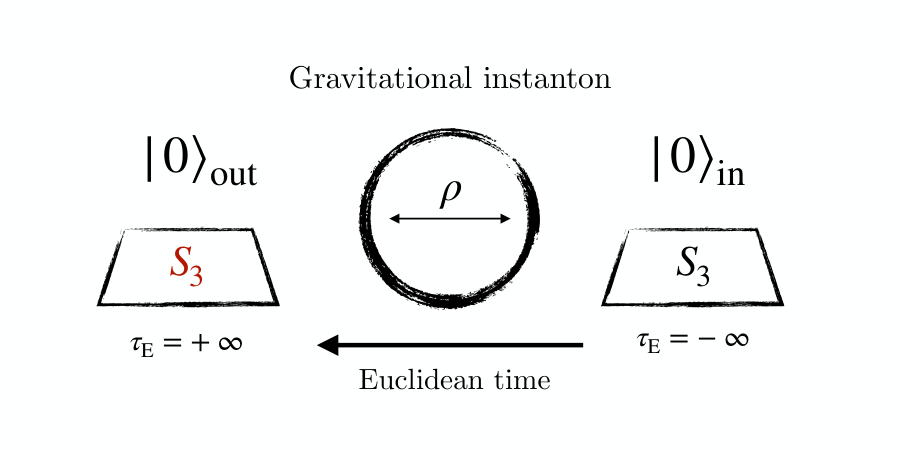
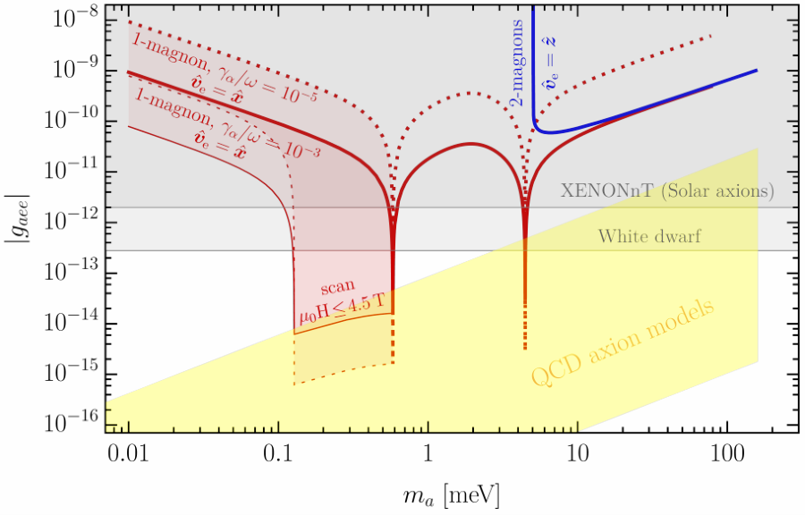
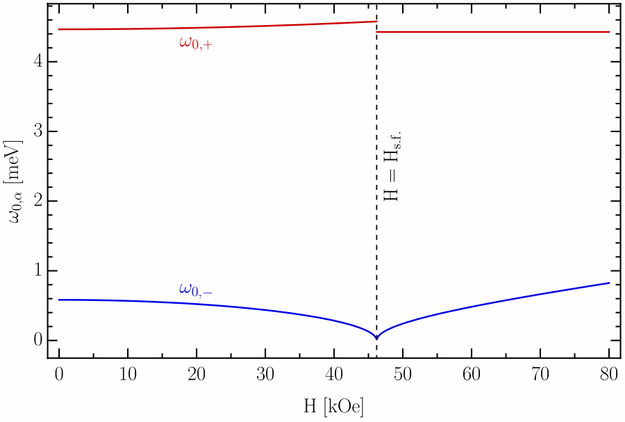
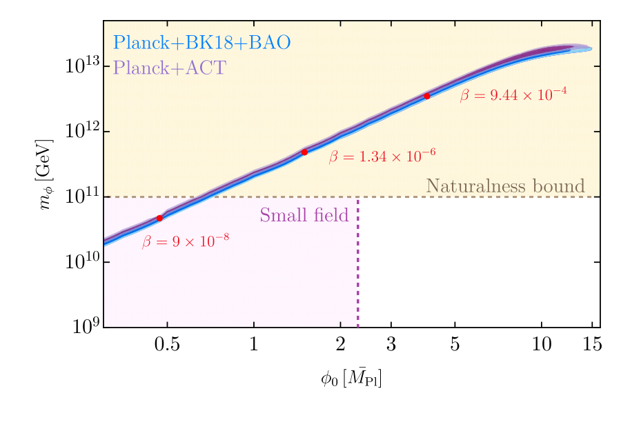

<!-- Each topic starts with "## Title".
     The picture line puts a figure on the right: {: .fig-right}
     Put the image file in the same folder as this page.
     "{: .key}" under the last line makes the "Key papers" line grey. -->

## The strong CP problem and axion quality

{: .fig-right}

The absence of a neutron electric dipole moment points to physics beyond the Standard Model. The QCD axion solves this strong CP problem, and could also be the dark matter, but only if gravity does not spoil the Peccei–Quinn symmetry: the axion quality problem. We computed the symmetry breaking induced by gravitational instantons in semiclassical gravity, using ’t Hooft operators as for small QCD instantons, and found it to be extremely small. Gravitational instantons therefore do not create a significant quality problem.

Key papers: [Catinari & Urbano 2024](https://arxiv.org/abs/2410.12741)
{: .key}

## Axion dark matter in antiferromagnets

{: .fig-right}

Tabletop experiments can search for dark matter with small, inexpensive setups. Nickel oxide is already a promising target for sub-MeV dark matter; we showed that it can also hunt meV-mass axion dark matter, including QCD axions that couple to electrons. Axions convert into one or two of its collective excitations, which gives a narrow-band and a broadband channel, and varying an external magnetic field extends the search down to fractions of an meV. We are now working to turn this proposal into an experiment.

Key papers: [Catinari, Esposito & Pavaskar 2024](https://arxiv.org/abs/2411.11971)
{: .key}

## Effective field theories of magnets

{: .fig-right}

I am interested in effective field theories for systems that spontaneously break Lorentz symmetry, which describe phenomena from cosmology to condensed matter. For anisotropic antiferromagnets in an external magnetic field, a simple effective theory already contains gapped Goldstone bosons, pseudo-Goldstones and a first-order spin-flop transition; quantizing it is subtle because of a term with a single time derivative. We matched the theory to nickel oxide.

Key papers: [Catinari, Esposito & Pavaskar 2024](https://arxiv.org/abs/2411.09761)
{: .key}

## Naturalness and the hierarchy problem

{: .fig-right}

Many cosmological solutions to the hierarchy problem rely on a trigger: a local operator sensitive to the Higgs mass squared. We showed that no trigger in the SMEFT up to dimension six, and by the same arguments dimension eight, can solve the problem far above the weak scale, so the signatures of the three known trigger operators can discover or exclude this whole class of solutions.

Gravity unavoidably couples the Higgs to any heavy sector, earlier than the top-quark loops usually considered. Applying finite naturalness, we found that large-field models of inflation are disfavoured, while small-field models need fine-tuned initial conditions.

Key papers: [Catinari, Tito D’Agnolo & Sesma 2025](https://arxiv.org/abs/2512.11026), [Catinari, Del Grosso, Di Giovanni & Urbano 2025](https://arxiv.org/abs/2504.17846)
{: .key}
